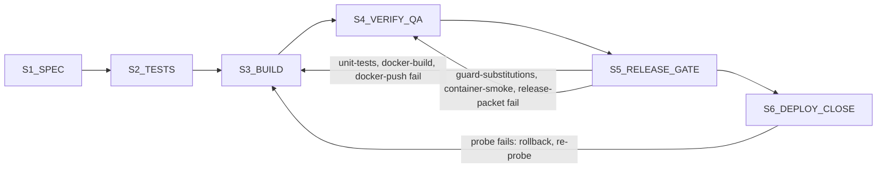

# Hybrid workflow (S1_SPEC to S6_DEPLOY_CLOSE)

Every change to osprey-core moves through six stages. The stages follow the factory workflow kit.

- S1 to S4 are **agentic**. Agents plan and do the work. A deterministic exit gate grades the evidence
  before the stage can close.
- S5 and S6 are **deterministic**. Fixed scripts run with no agent judgment. S5 runs Cloud Build CI.
  S6 runs Google Cloud Deploy CD.
- A failed deterministic check sends the release back upstream (`bounce_to`). The stage that owns the
  fix reopens, and every later stage is blocked again.

The machine-readable definition is `.workflow/workflow.yaml`. The console serves the same stages from
`config/workflow_stages.json` (GET `/api/workflow`). `tests/test_workflow_wiring.py` keeps both files in
sync with `config/cicd.json`, the DP-001 `stage_order`, and the roster in `config/agents.json`.

> The stage progress and audit receipts in the console are a **labelled sample release scenario**
> (`scenario: sample` plus a `source_label` in each config, returned by the API and shown in the UI).
> They are not live workflow state. Live CI/CD status at S5 and S6 comes from GET `/api/pipeline`.
> The acceptance criteria for the console itself live in `SPEC.md`.

## Stages

### S1_SPEC (agentic): spec and numbered acceptance criteria

- Owners: core-coordinator, core-planner, core-spec-writer.
- Entry: the request links to an Outcome and a Goal in the task backend. No open S1 task exists for the goal.
- Work: write `SPEC.md` with numbered acceptance criteria (AC-01 to AC-NN) and a test plan.
- Exit gate: `python -m pytest -q -p no:cacheprovider tests/test_honesty.py::test_spec_acceptance_criteria_are_numbered`
- Human gate: core-coordinator approves the spec. The approval becomes a signed receipt.

### S2_TESTS (agentic): test suite mapped to the acceptance criteria

- Owners: core-qa-release-subcoord, core-tester.
- Entry: the S1 exit receipt verifies PASS.
- Work: write happy-path, edge-case, and chaos tests for every acceptance criterion before the build.
- Exit gate: `python -m pytest -q -p no:cacheprovider tests/test_honesty.py::test_spec_acceptance_criteria_map_to_real_tests`
  (every acceptance criterion names tests that exist).

### S3_BUILD (agentic): implementation and test convergence

- Owners: core-backend-subcoord, core-frontend-subcoord, core-api-builder, core-ui-builder, core-db-builder.
- Entry: the S2 exit receipt verifies PASS. Each builder holds a disjoint file lease.
- Work: implement the spec until every test passes. Files stay at or under 400 lines. The AST
  zero-hardcoding gate stays green. Builders report done with commit SHAs.
- Exit gate: `python -m pytest -q -p no:cacheprovider` (100% pass, including the LOC and AST gates).

### S4_VERIFY_QA (agentic): independent verification

- Owners: core-reviewer-gemini, core-reviewer-opus, core-reviewer-fable (the QA council) and
  core-iap-security (the security audit).
- Entry: the S3 exit receipt verifies PASS at the same commit. No QA agent built the change.
- Exit: 3 of 3 council approvals with no open blocking findings.
- Exit: a Playwright sweep at 1440x900 and 390x844 with 0 console errors, 0 anomaly strings, and no
  horizontal overflow.
- Exit: a security audit by core-iap-security (IAP only, no committed secrets, DP-001 guard active).
- Exit gate: `python3 qa/e2e_console.py <base_url> <out_dir> <label>` plus the three council receipts.

### S5_RELEASE_GATE (deterministic): Cloud Build CI and the release packet

- Owners: core-coordinator, core-iap-security. Human gate: the release approval becomes a signed receipt.
- Entry: the S4 council decision is 3 of 3 PASS at the release commit. Tracked files are clean.
- Command: `python3 scripts/s5_release_gate.py --commit <HEAD sha>`
  - It runs `gcloud builds submit --config=cloudbuild.yaml` for that commit.
  - It writes the immutable release packet `.workflow/evidence/s5_release_packet.json`: the commit and
    the image `@sha256` digest.
- Exit gate: `python3 scripts/nightly_dream_evolver.py --out-root <scratch_dir>` (the DP-001 shadow replay;
  its summary must show gate PASS).
- Exit also needs: every Cloud Build step SUCCESS, the packet, the receipt chain PASS
  (POST `/api/receipts/verify`), and the human release approval.

### S6_DEPLOY_CLOSE (deterministic): Cloud Deploy CD, IAP probe, and rollback

- Owner: core-deployer. Set `WORKFLOW_STAGE=S6_DEPLOY_CLOSE` for the guard.
- Entry: the S5 packet pins the commit and the `@sha256` digest. The human release approval verifies PASS.
- Command: `python3 scripts/s6_deploy.py --packet .workflow/evidence/s5_release_packet.json`
  - It runs `gcloud deploy releases create` on the delivery pipeline osprey-core-cd with the packet image.
- Exit gate: `python3 scripts/s6_exit.py --packet .workflow/evidence/s5_release_packet.json --report .workflow/evidence/s6_deploy_report.json`
  - An unauthenticated GET answers 302 or 401. An IAP-authenticated GET answers 200.
  - GET `/api/pipeline` provenance matches the packet and the deploy report.
  - IAP, ingress all, min and max 1 instance, and the runtime service account are unchanged.
  - The osprey-onboard-sa run.invoker and IAP accessor bindings are unchanged.
  - For `IAP_TOKEN_COMMAND`, mint an OIDC ID token with `--audiences` set to the IAP OAuth client ID and verify the caller holds `roles/iap.httpsResourceAccessor` on the Cloud Run IAP web resource.
- Rollback: `python3 scripts/s6_rollback.py --execute`

## Control loops



### S5: a failed CI step bounces upstream

The failed Cloud Build step decides where the release goes back to:

- `unit-tests`, `docker-build`, `docker-push` fail: the code or the image is wrong. Bounce to S3_BUILD.
- `guard-substitutions`, `container-smoke`, `release-packet` fail: the release inputs or the running
  container are wrong. Bounce to S4_VERIFY_QA for a new verification.

The bounce reopens the target stage and blocks every later stage again (Mode 2).

### S6: probe, roll back, re-probe, bounce

1. `scripts/s6_exit.py` probes the new revision through IAP.
2. On failure, `python3 scripts/s6_rollback.py --execute` runs `gcloud deploy targets rollback`. If that
   fails, it shifts traffic back to the previous ready revision.
3. The exit gate runs again against the restored revision.
4. The release bounces to S3_BUILD with the probe report (Mode 2).

## Failure modes

1. **Agentic remediation.** An exit gate fails. The stage stays open and its owners fix the defect from
   the gate output (attempt 1 to `max_attempts`).
2. **Upstream or deterministic bounce.** A deterministic check fails. S6 rolls back and re-probes first.
   Then the `bounce_to` stage reopens and every later stage is blocked again.
3. **Human gate reject.** A human rejects S1 or S5. The stage restarts at attempt 0 with the feedback.
4. **Transient failure.** A command exits 75. It retries after 1, 2, and 4 seconds without using an attempt.
5. **Three strikes.** The third failed attempt halts the workflow (HALTED_ESCALATED) and alerts the human
   operator. Every stage has `max_attempts: 3`.

## Deterministic commands

- Whole loop (S5 then S6): `python3 scripts/workflow_ctl.py release --commit <sha>`
- S5: `python3 scripts/s5_release_gate.py --commit <HEAD sha>`
- S5 CI (run by the S5 script): `gcloud builds submit --config=cloudbuild.yaml`
- S5 exit gate: `python3 scripts/nightly_dream_evolver.py --out-root <scratch_dir>`
- S6: `python3 scripts/s6_deploy.py --packet .workflow/evidence/s5_release_packet.json`
- S6 CD (run by the S6 script): `gcloud deploy releases create`
- S6 exit gate: `python3 scripts/s6_exit.py --packet .workflow/evidence/s5_release_packet.json --report .workflow/evidence/s6_deploy_report.json`
- S6 rollback: `python3 scripts/s6_rollback.py --execute` (`gcloud deploy targets rollback`, then a traffic fallback)
- Register or update the pipeline (once, at S6): `gcloud deploy apply --file=clouddeploy.yaml --region=us-central1 --project=gement02`

## Cloud Build CI (S5)

`cloudbuild.yaml` runs six steps in order. Each step id has a bounce route in `.workflow/workflow.yaml`.

1. `guard-substitutions`: the commit substitutions are present and match the release commit (S4_VERIFY_QA).
2. `unit-tests`: pytest runs the full suite (S3_BUILD).
3. `docker-build`: builds the image from the digest-pinned `Dockerfile` (S3_BUILD).
4. `container-smoke`: starts the container and checks its health endpoints (S4_VERIFY_QA).
5. `docker-push`: pushes `us-central1-docker.pkg.dev/gement02/osprey-scion/osprey-core:$SHORT_SHA` (S3_BUILD).
6. `release-packet`: resolves the pushed tag to its immutable `@sha256` digest for the packet (S4_VERIFY_QA).

## Google Cloud Deploy CD (S6)

- `clouddeploy.yaml` defines the delivery pipeline osprey-core-cd with one target, osprey-core-prod.
- `skaffold.yaml` and `run-service.yaml` render the Cloud Run service.
- The target is Cloud Run in us-central1 behind IAP, with ingress all and min 1 and max 1 instance.
- The service runs as the runtime service account osprey-core-run. Cloud Deploy renders and deploys as
  the execution service account osprey-onboard-sa.
- `scripts/s6_deploy.py` creates the release from the packet. The image is always the `@sha256` digest,
  never a mutable tag.
- Provenance (commit, short SHA, build id, image digest, release, pipeline, target) reaches the revision
  as the environment variables listed in `config/cicd.json` (`provenance_env`).

## Evidence files

- `.workflow/evidence/s5_release_packet.json`: commit, Cloud Build build id and step results, image digest.
- `.workflow/evidence/s6_deploy_report.json`: Cloud Deploy release, rollout state, serving revision.
- `scripts/s6_exit.py` writes its IAP probe and re-probe reports next to them in `.workflow/evidence/`.
- `.workflow/evidence/` is runtime output. It is git-ignored (`evidence/` in `.gitignore`), and only the
  deterministic scripts write it. The guard blocks agent writes under `.workflow/` outside S1_SPEC.
- Receipts: each gate decision becomes an HMAC-SHA256 receipt chained to the previous one
  (`config/audit_receipts.json`, GET `/api/receipts`, POST `/api/receipts/verify`).
- `dreamstore/scorecard.json`: the DP-001 scorecard computed by `scripts/nightly_dream_evolver.py`.
- `qa/e2e_console.py` writes the S4 browser receipt and screenshots outside the repository.

## Live CI/CD status in the console

- `GET /api/pipeline` returns the live Cloud Build and Cloud Deploy state for the serving revision. Its
  settings live in `config/pipeline_status.json`.
- The Workflow tab shows it on the S5 and S6 stages. S5 shows the Cloud Build status, build id, image
  tag, digest, and steps. S6 shows the pipeline and target, the release, the rollout state, and the
  revision.
- `config/workflow_stages.json` adds two optional keys per stage for the UI: `bounce_to` (stage ids) and,
  on S5 and S6, `pipeline` (`kind`, `provider`, `config_file`, `command`).
- The stage progress stays a labelled sample. The pipeline status is live data.

## DP-001 PreToolUse guard

`dreamstore/hooks/dp001_pre_tool_guard.py` reads one tool-call event on stdin and exits `0` (allow) or
`2` (block, reason on stderr). It fails closed on empty, slow, oversized, or malformed input and on an
unreadable policy. The stage comes from the event's `stage` field or `WORKFLOW_STAGE`. An unknown or
missing stage blocks every stage-gated command.

Stage gates in the active policy (v1.1.0):

- From S5_RELEASE_GATE on: `gcloud run deploy`, `gcloud run services update-traffic` and `replace`,
  `gcloud builds submit`, `scripts/s5_release_gate.py --commit`, and `scripts/workflow_ctl.py release`.
- Only at S6_DEPLOY_CLOSE: `gcloud deploy releases create`, `gcloud deploy apply`,
  `gcloud deploy targets rollback`, `scripts/s6_deploy.py --packet`, and `scripts/s6_rollback.py --execute`.
- Reads stay allowed in every stage: `gcloud builds list`, `gcloud deploy releases list`, the S6 rollback
  dry-run, and the read-only `scripts/s6_exit.py` probe.
- The guard sees agent tool calls only. Subprocesses inside the deterministic scripts are not checked.

Claude Code (`.claude/settings.json`):

```json
{"hooks": {"PreToolUse": [{"matcher": "Bash|Write|Edit|MultiEdit",
  "hooks": [{"type": "command", "command": "python3 \"$CLAUDE_PROJECT_DIR/dreamstore/hooks/dp001_pre_tool_guard.py\""}]}]}}
```

Gemini CLI (`.gemini/settings.json`):

```json
{"hooks": {"BeforeTool": [{"matcher": "run_shell_command|write_file|replace",
  "hooks": [{"type": "command", "command": "python3 dreamstore/hooks/dp001_pre_tool_guard.py"}]}]}}
```

## Task backend and Night Dreaming

- **Task backend.** Stages map to native tasks in the selected backend (farmtable, github, jira, gitlab,
  beads, linear) through `.workflow/task_backend.py` and `config/task_backends.json`.
- **Night Dreaming.** `scripts/nightly_dream_evolver.py` replays curated scenario traces
  (`dreamstore/evals/ops_release_guardrails_shadow_replay.json`, modelled on common release failure
  modes, not recorded from live sessions) through the DP-001 guard under the baseline and candidate
  policy versions and writes the computed scorecard.

## Health checks on Cloud Run

Cloud Run's front end reserves some URL paths ending in `z` (for example `/healthz`). Checks through the
service URL and Cloud Run probes use `/health` (liveness) and `/ready` (readiness; `/readyz` is the same
handler). `/healthz` stays for container-local checks such as the Docker HEALTHCHECK. Smoke every
endpoint with `python3 qa/smoke_endpoints.py <url> <result-file>`.
